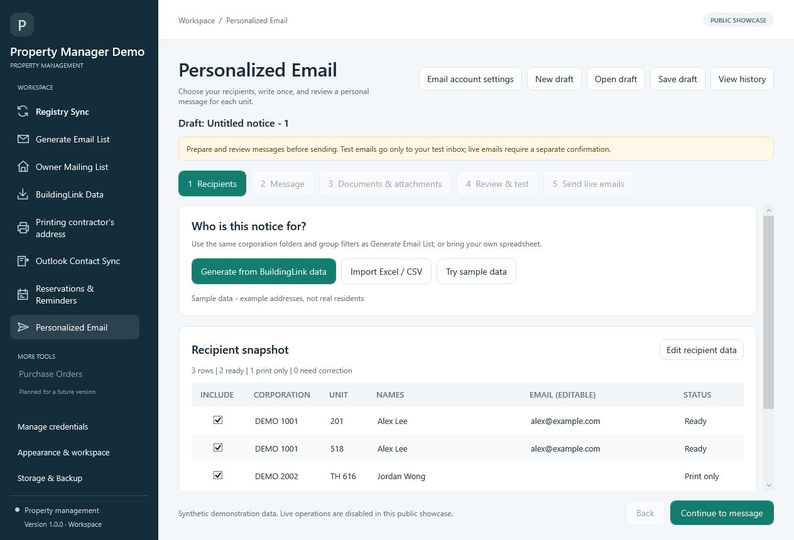
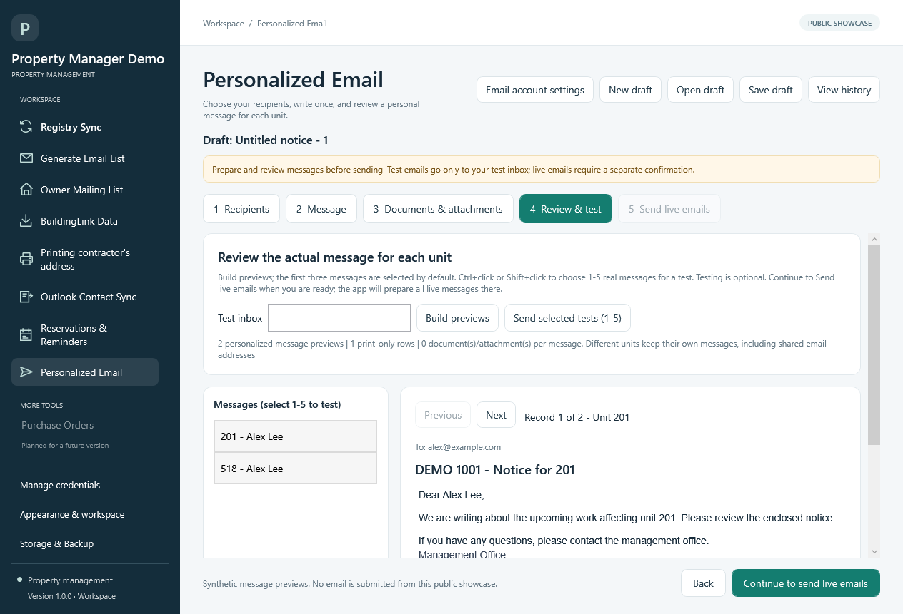

# Property Management Tool

A Windows desktop application that brings recurring property-management work into one workspace: invoice tracking, resident communication, contact maintenance, operational reminders and mailing preparation.

The application combines a **C# / WPF interface**, **Python automation workers** and **SQLite-backed records**. Its workflows emphasize previews, explicit approvals, recoverable changes and clear progress reporting.

> **Public showcase:** This edition uses fictional organization details and synthetic examples. Live service connections, email submission, Outlook access, scheduled tasks and direct printing are disabled. You can explore the interface and inspect the implementation without connecting office accounts.

## Workflows

The source contains implementations for the following areas. Connected operations remain blocked in this public edition.

| Workspace | What it supports |
| --- | --- |
| **Registry Sync** | Match registry entries with invoice/PO records; refresh workflow and payment information; preserve workbook layout; back up before saving; explain rows needing review. |
| **Generate Email List** | Filter occupants by resident/owner groups, units and floor/block; review addresses; control duplicate handling; export lists or pass recipients into a campaign. |
| **Owner Mailing List** | Combine occupant and unit records, prefer alternate mailing addresses and use property-address fallbacks; group owners by unit and export mailing lists. |
| **BuildingLink Data** | Manage shared corporation data folders and download workflows for occupant/unit data, with progress reporting and scheduling code. |
| **Contractor Address Printing** | Manage addresses and return-address logos; preview envelope/label layouts; choose label positions; generate envelope Word documents and track requests. |
| **Outlook Contact Sync** | Plan individual-contact and group updates, use a saved Contacts destination, review approvals and retain recovery history. |
| **Reservations & Reminders** | Prepare operational reminders from amenity bookings, repair cases and bulk-item requests, with previews and run history. |
| **Personalized Email** | Build a recipient snapshot, merge fields into messages and multiple Word/PDF attachments, manage HTML signatures, preview/test messages and track delivery outcomes. |

## Interface preview

### Review recipients before preparing a campaign

The recipient snapshot keeps unit associations visible and separates email-ready recipients from print-only records. The example below contains synthetic data.

### Inspect each personalized message

The review step lets users move between recipient-specific messages before submission. Test delivery and live delivery are separate steps; both are blocked in this showcase.

## Engineering highlights

- **Desktop orchestration:** WPF views coordinate background work through asynchronous services and Python workers. Structured JSON-line events carry progress, results and cancellation information back to the interface.
- **Reviewable automation:** Recipient previews, contact-change plans and request histories expose the proposed work before consequential actions.
- **Delivery-state tracking:** Campaign records distinguish accepted, failed and uncertain submissions so an ambiguous outcome is not automatically treated as safe to resend.
- **Recovery-aware storage:** SQLite stores, Windows-protected payloads, operation locks and verified app-data backups support recovery without replacing newer delivery records silently.
- **Workbook preservation:** Registry updates detect columns by header, retain spacing and formatting, and verify backups before replacing a workbook.
- **Bounded service access:** Request pacing, run-scoped caching and stop-on-block behavior are implemented in the registry transport.

See [Architecture](docs/ARCHITECTURE.md) for the component boundaries and [Testing](docs/TESTING.md) for the public validation scope.

## Technology

| Layer | Technologies |
| --- | --- |
| Desktop UI | C#, .NET 10, WPF/XAML |
| Automation workers | Python, Playwright, openpyxl |
| Local storage | SQLite, JSON compatibility files, Windows DPAPI and Credential Manager |
| Integration code | Yardi P2P, BuildingLink, Classic Outlook Object Model, SMTP with STARTTLS, desktop Microsoft Word |
| Mailing | Word document generation and Windows printer/driver interfaces |

## Run the public demo

On Windows with the **.NET 10 SDK** installed, double-click **[Open Public Demo.cmd](Open%20Public%20Demo.cmd)**. It builds and opens the full application. Registry Sync is the initial workspace; all workspaces are available in the sidebar.

For a populated example, open **Personalized Email**, create a draft and choose **Try sample data** on the Recipients step. No credentials are required.

Build files are kept outside this repository by the launcher. Python is needed only for the optional worker tests; desktop Word is needed for local Word/PDF generation.

See [Getting started](docs/GETTING_STARTED.md) for build commands and demo capabilities.

## Validation

The public snapshot has been built on Windows and checked with **31 offline Python tests**. Its eight live-operation entry points have also been checked to reject execution before connecting or submitting work. These checks use synthetic records and fake transports; they are not a live-service, physical-printer or clean-machine compatibility certification.

## Third-party notices

Third-party notices are retained in [ThirdPartyNotices.txt](PropertyManager.App/ThirdPartyNotices.txt) and [Assets/Licenses](PropertyManager.App/Assets/Licenses). This repository does not currently declare a project-wide license.
