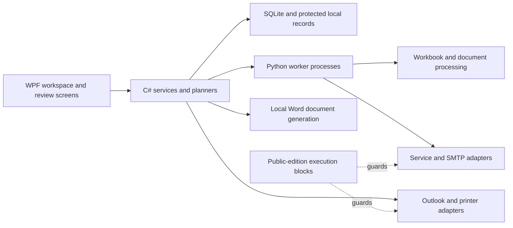

# Architecture

## Component boundaries

The diagram shows the implementation boundaries. In this public snapshot, entry points for live service access, Outlook, scheduling and direct printing reject execution. Local Word document generation remains available when Word is installed.

## Desktop shell

`PropertyManager.App` contains the WPF shell, shared styles, workspace navigation and feature views. Feature-specific services perform background work so the interface can report progress and cancellation without owning the underlying integration details.

Shared corporation configuration is reused by the data-download, email-list, owner-mailing and Outlook workflows. Appearance and storage controls are separate from feature-specific settings.

## Worker protocol

Registry, data-download, reminder and campaign workers live under `PropertyManager.App/Backend`. The desktop services launch them as child processes and exchange structured JSON-line messages through redirected streams. Events describe stages, row results, progress, completion and errors.

Cancellation is cooperative. Workflows check cancellation between operations and avoid treating an interrupted or uncertain external submission as a confirmed failure that can always be retried.

## Local data

The code uses several storage types according to their responsibilities:

- Shared settings and address data support an optional move into `app.db`, with integrity, decryption and content verification before activation.
- Outlook recovery, campaign delivery records and reminder history use their existing feature stores.
- Protected drafts, signatures and related snapshots retain their own formats.
- Windows DPAPI protects selected payloads for the current Windows account; Credential Manager stores account credentials.
- Worker-compatible JSON projections remain where required.

This is not a claim that all records live in one database or that the entire SQLite file is encrypted. The public application uses separate demo storage names and does not include populated production stores.

## Review and recovery

Outlook changes are planned before application and preserve recovery information. Campaign preparation freezes recipient/message information and attachment copies before submission. Delivery journaling distinguishes accepted and uncertain outcomes to reduce accidental duplicate sending.

Workbook updates use header-based column lookup, source-change checks, backup creation and staged replacement. App-data backup and migration share a verified backup mechanism with a user-selected destination.

## Integration policy

The public copy adds explicit guards around registry, download, reminder, SMTP, Outlook, task-scheduling and printer-submission entry points. Integration implementation remains visible for code review. The guards are a showcase policy, not a security sandbox against someone modifying the source.

## Source map

| Directory | Responsibility |
| --- | --- |
| `PropertyManager.App/Backend` | Python workers, workbook handling, browser extraction and transport logic |
| `PropertyManager.App/EmailLists` | Recipient selection, grouping, exports and mailing-address logic |
| `PropertyManager.App/OutlookSync` | Contact/group planning, gateways, recovery and verification |
| `PropertyManager.App/PersonalizedEmail` | Drafts, merge processing, preparation, signatures and delivery state |
| `PropertyManager.App/Envelopes` | Address layouts, labels, Word output and printer abstractions |
| `PropertyManager.App/Settings` | Shared settings storage, migration and backup |
| `tests` | Curated synthetic/offline regression tests |
